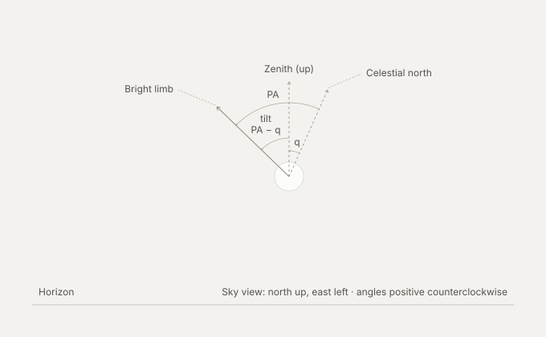

Moon Attributes
================================================================================
**Table of Contents**:
1. [Phase Attributes](#phase-attributes) — where the Moon sits in its cycle,
   which drives the naming and posting schedule.
1. [Rendering Attributes](#rendering-attributes) — how it looks from a given
   place at a given moment.

Phase Attributes
--------------------------------------------------------------------------------
Phase is determined by **elongation in longitude**, the difference between the
Moon's and the Sun's **geocentric apparent ecliptic longitude**, running 0° to
360°. It is geocentric by definition, so every observer on Earth shares the same
instant and only the local clock time differs.

| Elongation | Phase             |
|-----------:|-------------------|
| 0°         | 🌑  New           |
| 90°        | 🌓  First quarter |
| 180°       | 🌕  Full          |
| 270°       | 🌗  Last quarter  |

### Phase event
Computed in [`src/ephemeris/phase.ts`](../src/ephemeris/phase.ts) with
[`astronomia/moonphase`](https://github.com/commenthol/astronomia), which
implements Meeus, *Astronomical Algorithms* 2nd ed., chapter 49, and is about
10× more accurate than SunCalc's `phase`.

Rendering Attributes
--------------------------------------------------------------------------------
### Phase / illumination shape
**Phase angle** (*i*) and **illumination fraction** (*k*) are one quantity in
two coordinates, not two attributes. The phase angle is the geometry, the
illumination fraction is a reparameterization of it.

Neither value says which side is lit. A waxing and a waning moon with the same
*k* are mirror images. Resolve this from [PA](#position-angle-of-the-bright-limb-pa)
or from SunCalc's `waxing` field.

#### Phase angle (*i*)
The Sun-Moon-observer angle, ~180° at new moon and ~0° at full moon.

**Do not conflate this with the [phase](#phase-attributes)** (elongation in
longitude, or SunCalc's `phase` × 360°.) They are related but are *not*
reparameterizations of each other. Elongation runs 0–360° and separates waxing
from waning. The phase angle runs 0–180°, so it folds the two halves of the
month together. Elongation in longitude also ignores the Moon's ecliptic
latitude (up to ~5°). That latitude keeps the phase angle off 0° and 180°
except near eclipses.

#### Illumination fraction (*k*)
The fraction of the visible disc that's lit, from ~0 (new) to ~1 (full). Neither
endpoint is normally reached (except during eclipses): *k* ranges 0.997–1 at
full and 0–0.003 at new. Derived from the phase angle,
`k = (1 + cos(phase angle)) / 2`.

```js
SunCalc.getMoonIllumination(date).fraction
```

#### Position angle of the bright limb (*PA*)
Measured from the disc's celestial-north point, eastward, to the midpoint of the
illuminated edge. This tells you *which side* of the disc (in sky/equatorial
terms) is lit.

In degrees, from −180° to 180°. Meeus gives *χ* as 0–360°, so add 360° to negative
values when comparing.

```js
SunCalc.getMoonIllumination(date).angle
```

### Tilt
#### Parallactic angle (*q*)
The angle at the Moon's position on the sky between the directions to the
celestial north pole and to the local zenith: the Moon's vertex of the
pole–zenith–Moon triangle. You need this to rotate *PA* out of the equatorial
frame and into "as the observer actually sees it" — i.e. how the crescent is
tilted relative to straight-up on screen.

In degrees, from −180° to 180°: 0° when the Moon is on the meridian, positive
west of it (Meeus 14.1).

```js
SunCalc.getMoonPosition(date, lat, lng).parallacticAngle
```

The two angles compose: *PA* gives orientation relative to celestial north, and
*q* rotates it into the observer's local up/down. Both are measured from
celestial north, positive toward east (counterclockwise with north up, as you
see the sky). *q* is the position angle of the zenith, so the bright limb's
angle from straight up is *PA* − *q* (Meeus ch. 48: *χ* − *q*).



Dashed lines are reference directions (zenith, celestial north); the solid line
is the bright-limb direction.

```js
// degrees, counterclockwise from straight up; the difference spans −360° to
// 360°, so wrap it if you need one range
const tilt =
  SunCalc.getMoonIllumination(date).angle -
  SunCalc.getMoonPosition(date, lat, lng).parallacticAngle;
```

CSS `rotate()` is clockwise-positive, so draw it with `rotate(${-tilt}deg)`.

### Sky position
- **Altitude / elevation** — apparent angle above the horizon. Determines
  whether the Moon is visible at all, and feeds into extinction. SunCalc's
  `getMoonPosition().altitude` is already topocentric: it subtracts parallax (up
  to ~1° at the horizon) and adds refraction (~0.5° at the horizon).
- **Azimuth** — compass bearing. Sets horizontal screen position in any
  horizon-based (alt-az) rendering.

### Size
- **Angular diameter** — apparent size to draw, computed from the Moon's
  distance. Geocentric, it ranges from about 29.4′ to 33.5′ over the years; a
  single month spans less.
- **Distance** — geocentric, in km (`getMoonPosition().distance`). Needed for
  angular diameter. SunCalc has no topocentric distance; the observer is up to
  one Earth radius closer when the Moon is overhead, which makes it ~1.7% larger
  than the geocentric size.

### Optional refinements
- **Libration (optical, in longitude and latitude)** — the slight wobble that
  exposes slightly different edges of the near side over time. Matters if you're
  texture-mapping real lunar surface detail rather than just drawing a phase
  silhouette.
- **Position angle of the rotation axis (*P*)** — needed alongside libration if
  you want surface features (maria, craters) correctly oriented rather than just
  the phase shape.
- **Atmospheric extinction / color** — not geometric, but elevation-dependent
  dimming and reddening is what gives a rising/setting moon its orange "harvest
  moon" look, if you want that realism.
