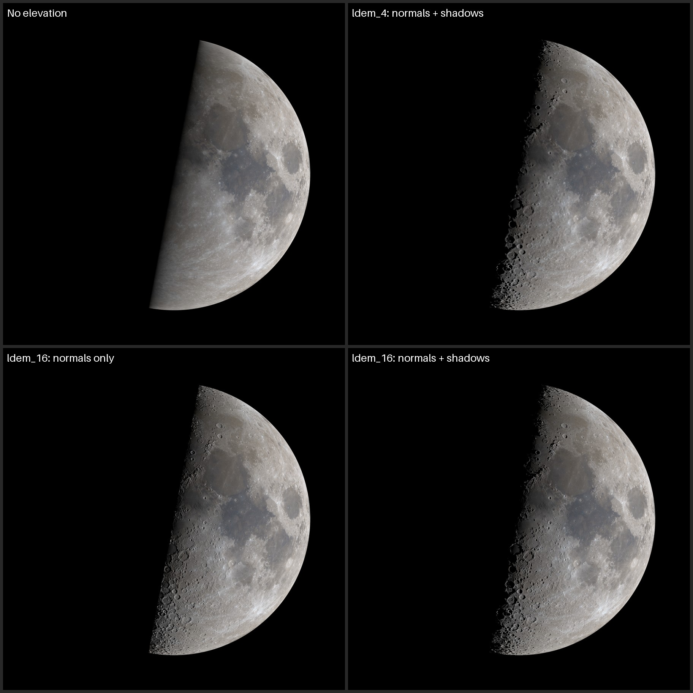
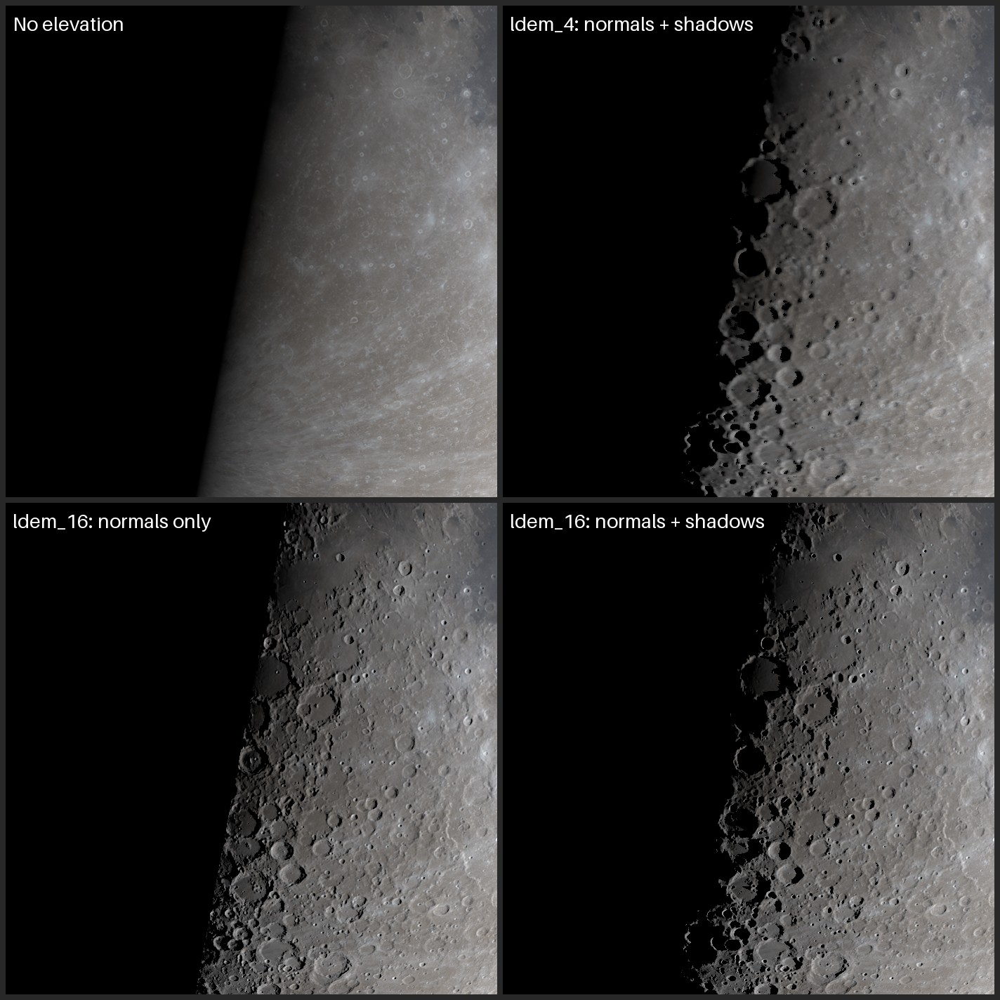

Moon Renders with Elevation Map
================================================================================
**This document tests whether the moon image needs NASA's LOLA elevation map.**
The renderer draws the Moon from two textures in NASA's
[CGI Moon Kit](https://svs.gsfc.nasa.gov/4720): the LROC color map and a LOLA
elevation map. The color map is adapted from the Hapke-normalized WAC mosaic,
so it holds albedo with almost no shading baked in. All of the relief has to
come from the elevation map.

In short, keep it. Use `ldem_16` with cast shadows. Without elevation, a quarter
moon renders as a smooth ball with a straight terminator, and half of all posts
are quarters. The shadow pass turned out cheap enough that deferring it saves
little.

What Depends on Elevation
--------------------------------------------------------------------------------
The renderer uses height twice. Finite differences of it give surface normals,
and a ray march over it toward the Sun gives cast shadows. Both only matter
where the Sun is low.

| Phase         | Effect of dropping elevation                                         |
|---------------|----------------------------------------------------------------------|
| Full          | Almost none. The Sun is behind the viewer, so nothing casts a shadow |
| New           | None. Earthshine lights the disc from the view direction             |
| First quarter | Large. The terminator crosses the middle of the disc                 |
| Last quarter  | Large, for the same reason                                           |

Renders
--------------------------------------------------------------------------------
The first quarter of 2026-10-18 16:12 UTC, rendered four ways:

1. No elevation. Smooth sphere normals, no shadows.
1. `ldem_4` (4 px/deg). Normals and shadows.
1. `ldem_16` (16 px/deg). Normals only. Slopes past the smooth terminator stay
   dark, since nothing tests whether terrain blocks them.
1. `ldem_16`. Normals and shadows.

### Whole disc
Each tile is scaled to 900 px, about what a phone shows in the feed.

### Terminator at full resolution
Each tile is a 700 × 700 px crop of the 2000 px render, on the terminator south
of the disc center, where the highlands are full of craters.

### What each variant looks like
| Variant                    | Whole disc                                           | Terminator crop                                                                |
|----------------------------|------------------------------------------------------|--------------------------------------------------------------------------------|
| 1. No elevation            | Straight terminator. Reads as CG                     | No relief. A soft gradient fades into black                                    |
| 2. `ldem_4`, shadows       | Hard to tell apart from 4                            | Large craters cast shadows, but the edges step at the 7.6 km texel             |
| 3. `ldem_16`, normals only | Textured, but the terminator is still a smooth curve | Crater rims show. Crater floors stay gray                                      |
| 4. `ldem_16`, shadows      | Ragged terminator, like a photo                      | Crisp shadows that follow the terrain, and a few lit peaks past the terminator |

At feed size the real gap is between 1 and the rest. Variant 2 only falls
behind 4 when someone opens the full-size image.

Cost
--------------------------------------------------------------------------------
| Variant                    | Download         | Render time on an M1 |
|----------------------------|------------------|---------------------:|
| 1. No elevation            | None             |                0.6 s |
| 2. `ldem_4`, shadows       | 2.0 MB (`uint`)  |                1.3 s |
| 3. `ldem_16`, normals only | 31.7 MB (`uint`) |                1.0 s |
| 4. `ldem_16`, shadows      | 31.7 MB (`uint`) |                2.6 s |

The shadow march was about 25 lines of vectorized numpy and added 1.6 s. It
only runs on lit pixels where the Sun's elevation over the smooth sphere is
under about 17°, plus a band up to about 9° past the terminator, where
mountain peaks can still catch the Sun. Pi 3 timing is unmeasured. It will be
several times slower, which is still fine for one image per post.

Setup
--------------------------------------------------------------------------------
- **Geometry.** From astronomia `moon.physical` (Meeus ch. 53): libration
  *l* = −2.64°, *b* = +3.62°, subsolar point at 87.12° E, −1.31°, axis *P* =
  350.62°, and an angular diameter of 29.66′ at 402,752 km.
- **Projection.** Orthographic, geocentric, celestial north up, with selenographic
  east on the right.
- **Frame.** 2000 px square. The plate scale is 0.9 × 2000 / 33.5′ =
  53.7 px/arcmin, so the largest possible Moon fills 90% of the frame. This one
  is 1594 px across.
- **Color.** `lroc_color_16bit_srgb_4k.tif`, decoded to linear light.
- **Elevation.** The float versions, `ldem_4.tif` and `ldem_16.tif`, in km
  relative to a 1737.4 km sphere.
- **Shading.** Lunar-Lambert with McEwen's (1991) *L*(α), normalized to *i* = 30°,
  *e* = 0°, α = 30°. No global phase function.
- **Shadows.** Rays step 0.75 texel toward the Sun and stop at the first terrain
  hit or when they climb above the highest point on the map.

### Checks
- **Map alignment.** The maria are dark and low, so near-side albedo should
  correlate positively with height. It does: +0.45 for both maps as loaded,
  and −0.38 with the elevation map shifted 180°.
- **Geometry.** With a uniform albedo and zero height, the lit fraction comes
  out 0.499 against an expected *k* of 0.501, lit on the right.
- **Shadow march.** On a flat height map it finds no shadows at any Sun
  elevation from 0.5° to 15°.

Caveats
--------------------------------------------------------------------------------
- **The color map is 4k, not 8k.** A disc this size needs the 8k map for full
  detail at its center. The softness affects all four variants the same way.
- **The limb is roughly anti-aliased.** Edge coverage comes from the distance to
  the limb, not from supersampling.
- **Exposure isn't tuned.** No variant was adjusted to match Dial-a-Moon.
- **Variant 3 is a design choice.** A normals-only renderer could instead let
  sunward slopes past the terminator light up. That would look closer to 4 but
  would also light slopes that terrain actually blocks.
- **The prototype isn't in the repo.** It was a throwaway numpy script, not the
  project's TypeScript renderer.

Rendered 2026-10-21 against commit `3e3863c`.
